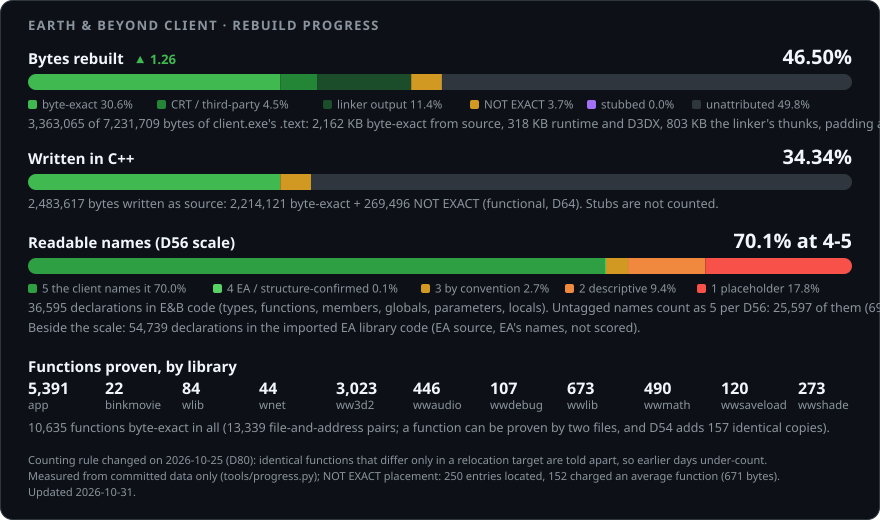
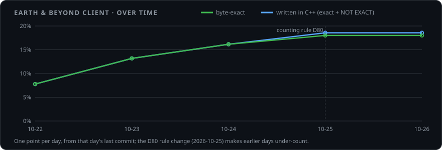
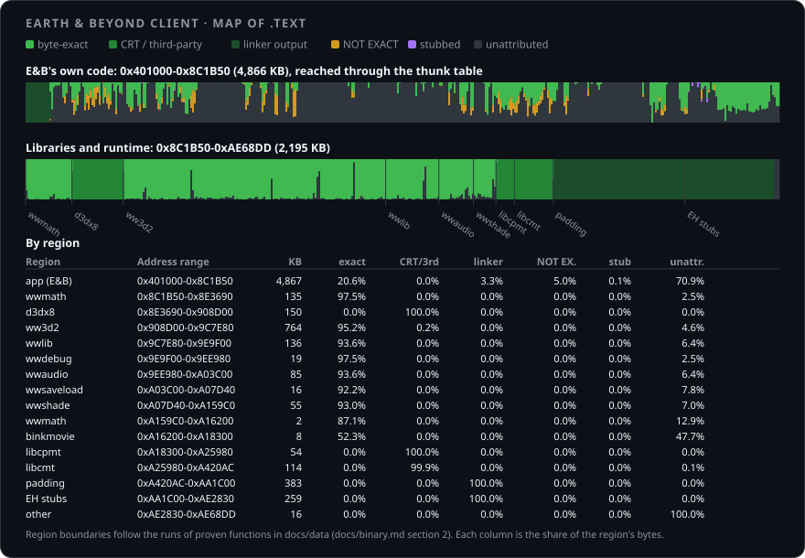

# Earth & Beyond client: C++ reconstruction

A byte-exact reconstruction, in C++, of the Earth & Beyond game client (`client.exe`, built
2004-03-16 with Visual C++ 6.0 SP4): source that compiles back to the same machine code as the
retail executable, with the original class names and Westwood's coding conventions. The retail
file is identified by its SHA-256, `249f852496f341c00361be95b66e7c0becc2c39e7cba026f9227e38b602651c4`
([docs/binary.md](docs/binary.md)).

Earth & Beyond shares Westwood's WWVegas libraries (WWLib, WW3D2, WWMath, WWAudio, WWSaveLoad,
...) with Command & Conquer Renegade and Generals / Zero Hour, whose source EA has published
under the GPL. **Where the client contains that code, it is imported from EA's release**, file by
file and function by function, with the changes E&B made. **The rest, E&B's own code, is reverse
engineered** from the executable and rebuilt until its functions match.

## Status

<!-- progress:start -->
As of 2026-10-26, **18.01%** of client.exe's `.text` is rebuilt byte for byte (5,998 functions) and **18.57%** is written in C++. Of 10,638 declarations in E&B's code, **81.4%** score 4-5 on D56's name scale (untagged names count as 5, 81.1% of all).

[](tools/progress.py)




<!-- progress:end -->

The card is regenerated daily by [tools/progress.py](tools/progress.py) from the data committed in
`docs/data/`; the definitions of each bar are in the footnote of the card and in
[docs/README.md](docs/README.md). The counting rule changed on 2026-10-25 (decision D80: identical
functions that differ only in a relocation target are now told apart), so the early part of the
chart is a slight undercount.

## How it is verified

A function counts only when it is proven. Each source file is compiled with the original Visual
C++ 6.0 SP4 toolchain (in a pool of build VMs) and every compiled function is compared, byte for
byte with relocations masked, against the function at the same address in the retail
`client.exe`; the result is recorded per file in `docs/data/imports.json` as a set of
`(file, address)` pairs. A change is kept only if that set gains pairs and loses none
(`tools/vc6/pairs_cmp.py` compares the sets, because totals hide swaps). Code written from
decompiler output rather than from matching bytes is marked `// NOT EXACT:` and counted
separately, and every name chosen without the client's own evidence carries a `// NAME n:`
certainty tag. The byte comparison needs the VMs and the retail client, so it runs on the
maintainer's machine; what CI checks is documented in [.github/workflows/](.github/workflows/).

## What is deliberately not here

* **The client and EA's data.** `client.exe`, the game's assets and anything from an install
  folder are not distributed: they are not ours to publish. The tools expect you to point them at
  your own copy.
* **The toolchain.** Visual C++ 6.0, the DirectX 8 SDK, the Miles and Bink SDKs and the build
  VMs are Microsoft's and RAD's. [docs/toolchain.md](docs/toolchain.md) says exactly which
  versions reproduce the client.
* **Recordings.** Packet captures, gameplay recordings and VM images used for testing stay on the
  maintainer's disk (`tools/prepush_check.py` refuses to let them in).
* **Pre-compiled library code** (the C runtime, the C++ standard library, D3DX): proven identical
  to Microsoft's libraries by [docs/library-matching.md](docs/library-matching.md) section 3.7,
  and counted as "CRT and third-party code", not as ours.

## Layout

The repository root stands for the original build tree, `e:\build\beta\G\`
([docs/source-tree.md](docs/source-tree.md)).

```
app/ libs/          E&B's own code (G\app, G\libs)
ww3d2/ wwlib/ ...   the imported and adapted Westwood libraries
stubs/ programs/    stand-ins for what is not reconstructed yet; test programs (VIDTEST)
tests/              test programs
tools/re/           reverse-engineering tools (Python)
tools/vc6/          the VC6 build and byte-matching loop
tools/harness/      capture and test harness
docs/               documentation; generated data in docs/data/
```

## Reading the documentation

[docs/README.md](docs/README.md) is the index. Start with [docs/progress.md](docs/progress.md)
(log, decisions D1..., open questions), then [docs/workflow.md](docs/workflow.md) for the fix
loop and the known traps. [CLAUDE.md](CLAUDE.md) and [docs/builders.md](docs/builders.md) are
the working rules; much of this project is done by AI agents under them.

## Contributing

See [CONTRIBUTING.md](CONTRIBUTING.md). In short: read the rules, keep a change only if it gains
verified pairs and loses none, and never commit binaries.

## Licence

GPL v3 with Electronic Arts' additional terms, because the repository includes EA's published
Westwood code ([LICENSE](LICENSE)). This is an unofficial fan reconstruction and is not
affiliated with or endorsed by Electronic Arts. Modified versions must be marked as such and
must not be presented as the original.
